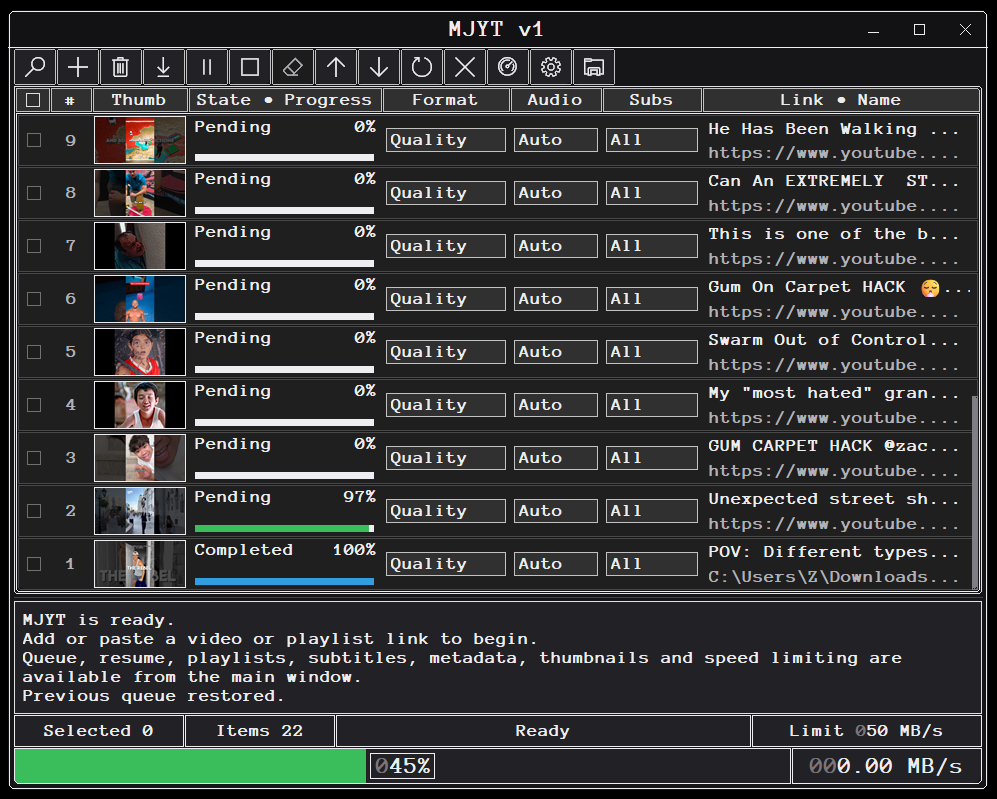
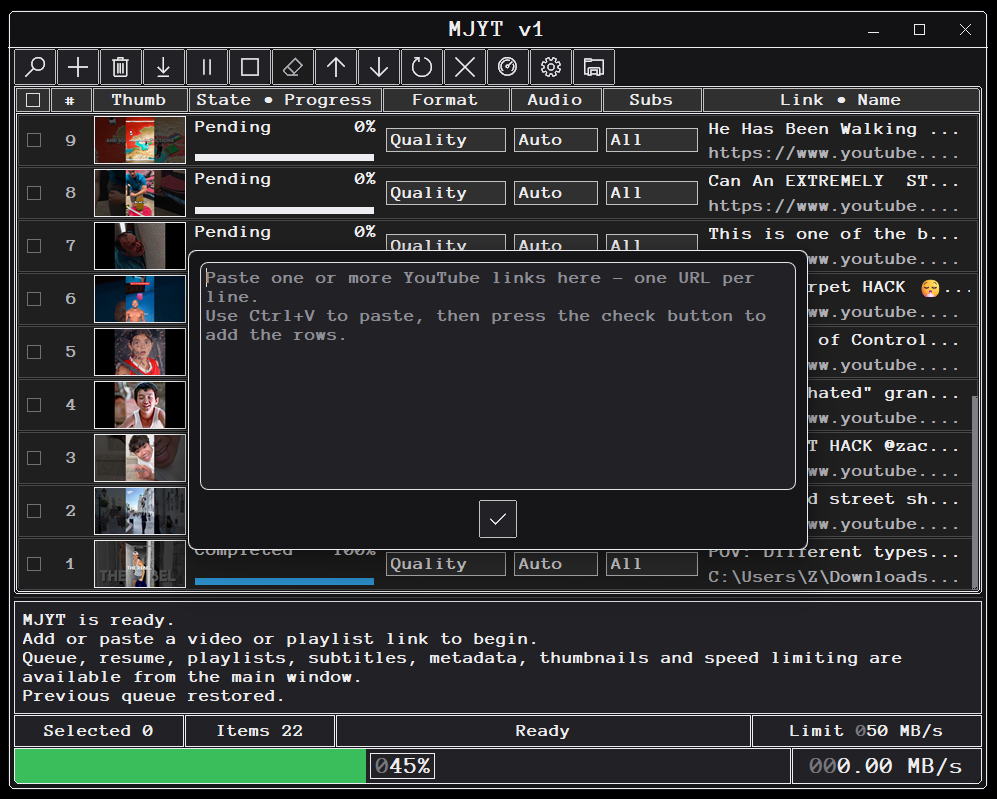
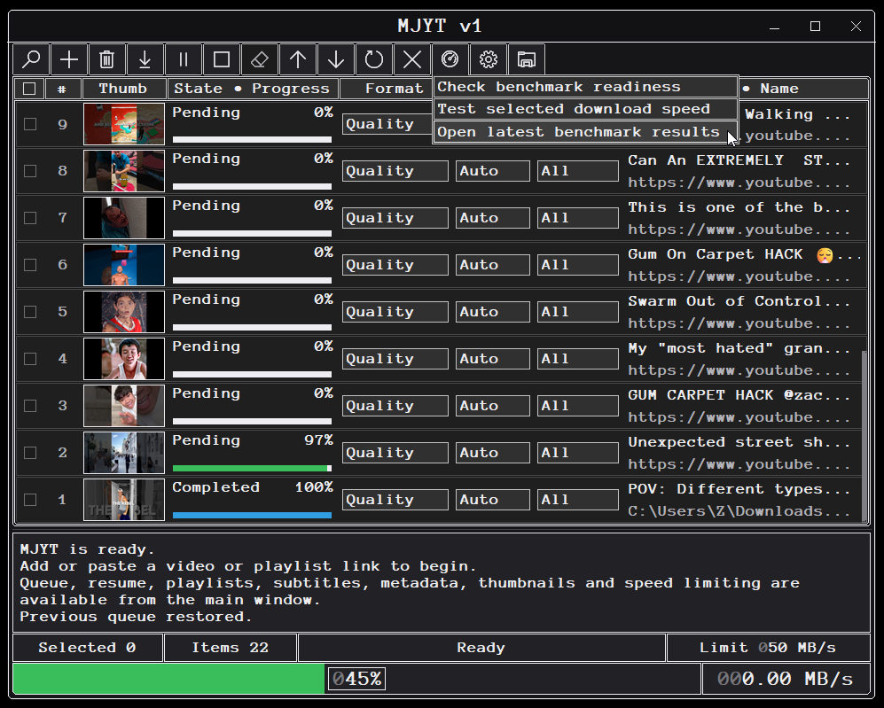
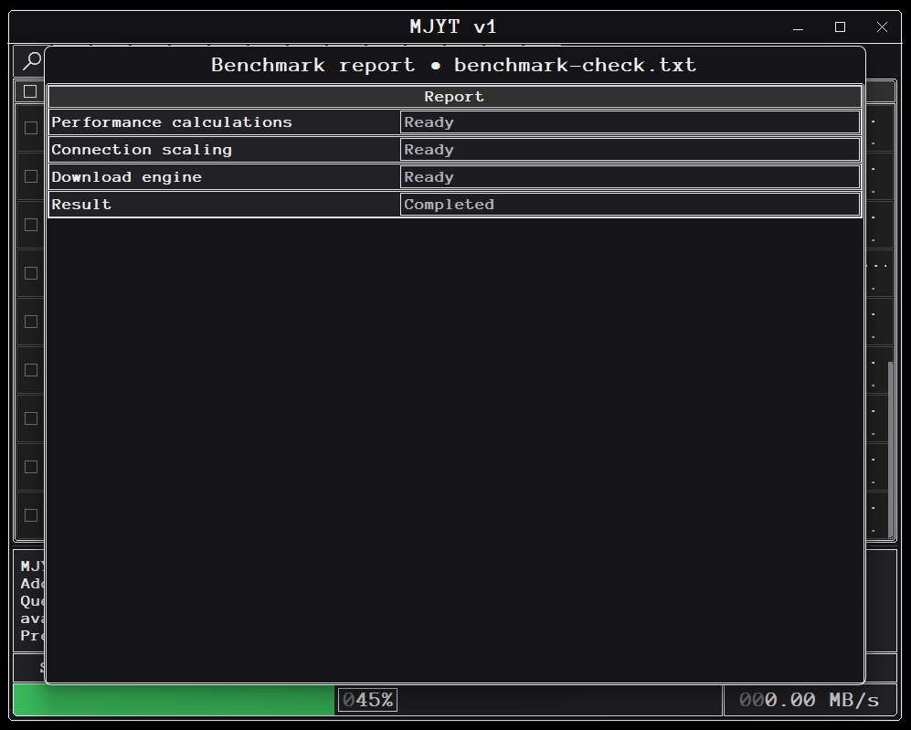
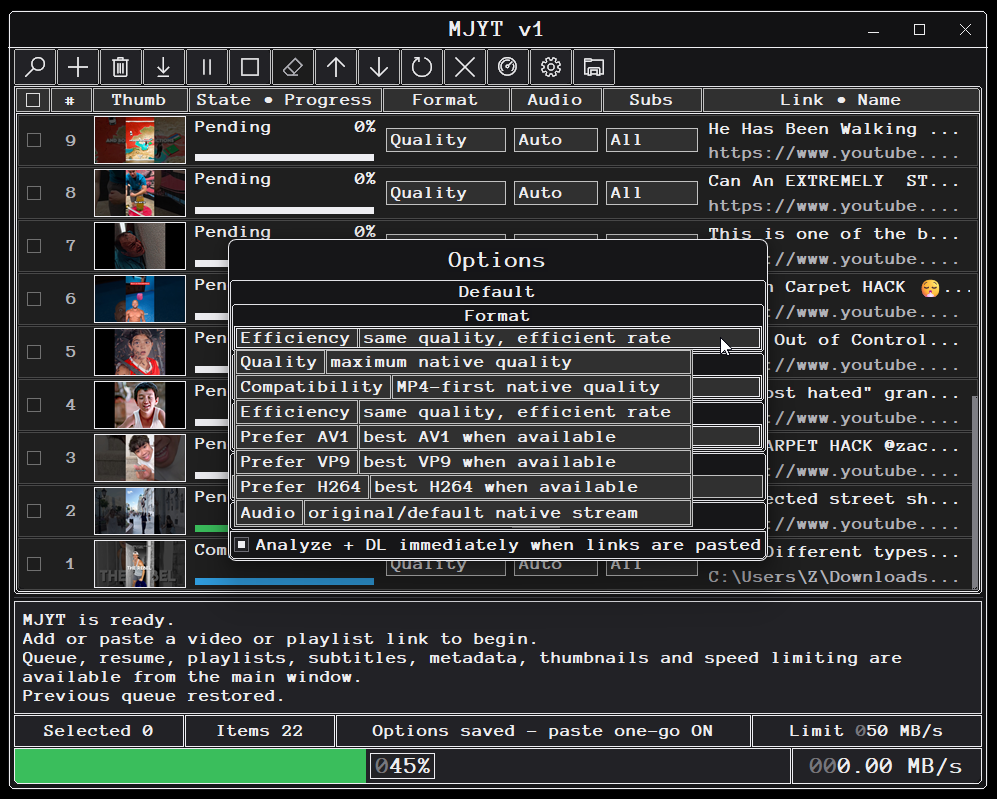
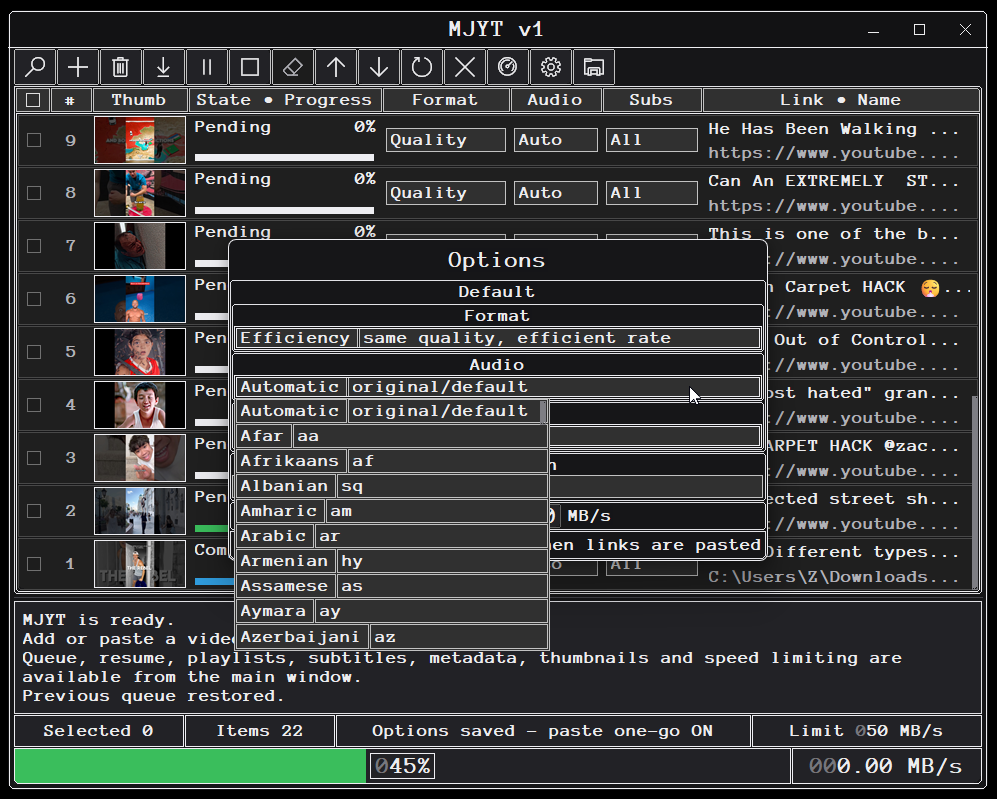
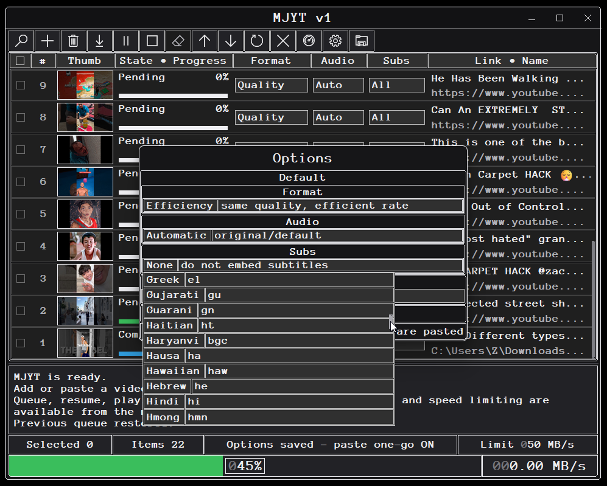

# MJYT

MJYT v1.1 is a native Windows x64 YouTube downloader focused on a compact, responsive desktop UI and a portable single-executable runtime.

## Highlights

- Download public YouTube videos, standard playlists, generated radio Mixes, and public YouTube Music compilation playlists.
- Choose video format, audio track/language, and subtitle policy.
- Download adaptive media streams and supported live streams.
- Embed metadata, cover artwork, and selected subtitles into the resulting media when supported.
- Queue multiple links, reorder work, retry items, pause/resume supported transfers, and retain queue state.
- Show video thumbnails directly in the queue.
- Configure destination, default format/audio/subtitle behavior, automatic paste-and-download behavior, bandwidth limits, and optional new-version checks.
- Run the built-in download benchmark from the UI.
- Native dark Windows interface with a portable application icon and no installer requirement.
- No downloader, JavaScript engine, FFmpeg, or other helper executable is required at runtime.

## Download

For normal use, download the Windows x64 package from the [GitHub Releases page](https://github.com/MarceloAlejandroJorquera/MJYT/releases), extract it, and run `MJYTv1.1.exe`.

MJYT is portable. It does not require installation.

## Basic usage

1. Run `MJYTv1.1.exe`.
2. Paste or add one or more supported YouTube links.
3. Choose the destination and any format/audio/subtitle options you want.
4. Start the download.
5. Completed media is written directly to the selected destination.

The **Add Links** dialog accepts YouTube video and playlist URLs. Malformed or unsupported text is ignored.


## Screenshots

### Main window


### Add Links dialog


### Benchmark


### Download report


### Options




## Update checks

The **Check new versions** option is available in **Options** and is enabled by default. When enabled, MJYT checks the latest GitHub release about 10 seconds after startup and then about every 6 hours. Checks run asynchronously and never download or execute an update automatically. A notification shows the installed and newest release labels and can open that release's GitHub page. Disable the option to stop version lookups.

## Supported platform

- Windows 10/11 x64
- 64-bit builds only

## Current limitations

- MJYT is intended for YouTube URLs; it is not a general multi-site downloader.
- Private, members-only, account-authenticated, rented/purchased, or DRM-protected media is not supported.
- Availability still depends on the media being accessible to the application and on YouTube's current delivery behavior.
- YouTube can change its web/player interfaces. A future YouTube change may require an MJYT update.

## Building from source

Prerequisites:

- Windows x64
- Microsoft Visual C++ Build Tools / MSVC x64
- CMake 3.24 or newer
- Windows PowerShell 5.1 or newer
- Internet access on the first build so the pinned Ninja build tool can be provisioned and verified

Run the fully qualified Release build:

```powershell
.\run.bat
```

The resulting qualified release executable and its direct checksum manifest are:

```text
dist\MJYTv1.1.exe
dist\SHA256SUMS.txt
```

`dist\SHA256SUMS.txt` contains the SHA-256 of `MJYTv1.1.exe` generated from the qualified release binary.

For local incremental development builds, use:

```powershell
.\run-fast.bat
```

See [`docs/BUILDING.md`](docs/BUILDING.md) for additional details.

## Versioning

MJYT uses lineage-style release labels rather than Semantic Versioning. The release sequence begins at `v1`, then advances as `v1.1`, `v1.1.1`, `v1.1.1.1`, `v1.1.1.2`, and so on. Versions preserve the lineage label exactly and are not padded with zero components. See [`docs/VERSIONING.md`](docs/VERSIONING.md).

## Release integrity

Official releases include a portable ZIP containing the EXE and its SHA-256 manifest, plus an external SHA-256 manifest for release assets. Provenance is retained in local release staging. Verify the downloaded artifact against `SHA256SUMS.txt` from the same release.

## Licensing

MJYT itself currently has **no open-source redistribution license**. Source availability does not grant redistribution or modification rights. See [`LICENSE.txt`](LICENSE.txt).

Bundled third-party assets retain their own licenses. See [`docs/THIRD_PARTY.md`](docs/THIRD_PARTY.md).

## Disclaimer

MJYT is not affiliated with or endorsed by YouTube or Google. Users are responsible for complying with applicable laws, copyright requirements, and service terms when downloading media.
